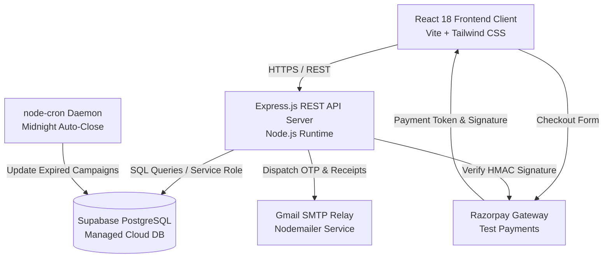
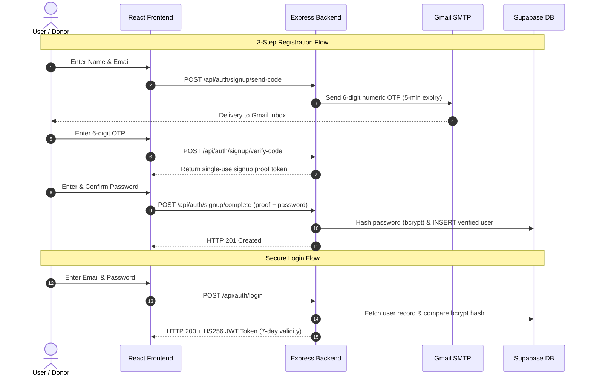
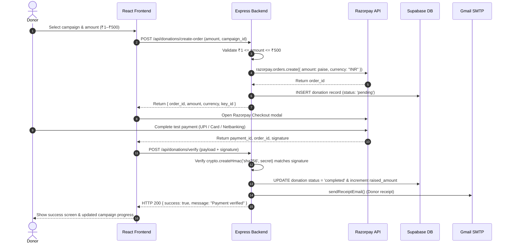
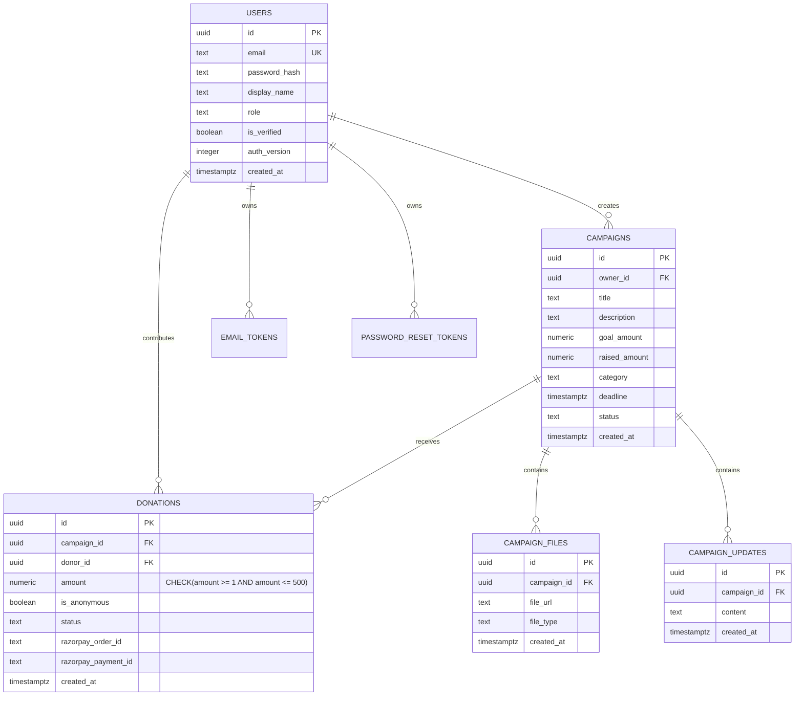

# Micro Donation Platform — SE Mini Project Team 10

> **Donate ₹1 to ₹500 to verified causes with complete transparency and trust.**  
> Built with React 18, Node.js/Express, Supabase (PostgreSQL), and Razorpay.

[](https://github.com/NikhitaUppar/SE-project-Team10/actions)
[](micro-donation-platform/backend/tests/)
[](micro-donation-platform/backend/)
[](LICENSE)

---

## Table of Contents
1. [Project Overview](#project-overview)
2. [Problem Statement](#problem-statement)
3. [Project Objectives](#project-objectives)
4. [Main Features](#main-features)
5. [Technology Stack](#technology-stack)
6. [System Architecture & Workflows](#system-architecture--workflows)
7. [Project Folder Structure](#project-folder-structure)
8. [Prerequisites & Software Requirements](#prerequisites--software-requirements)
9. [Installation & Setup](#installation--setup)
10. [Configuration & Environment Variables](#configuration--environment-variables)
11. [Running the Application Locally](#running-the-application-locally)
12. [Testing & Quality Assurance](#testing--quality-assurance)
13. [API Endpoints Catalog](#api-endpoints-catalog)
14. [Database Architecture & Schema](#database-architecture--schema)
15. [Deployment Guide](#deployment-guide)
16. [Team Members & Contributions](#team-members--contributions)
17. [Application UI Walkthrough](#application-ui-walkthrough)
18. [License](#license)

---

## Project Overview

The **Micro Donation Platform** is a web-based crowdfunding and philanthropic platform engineered specifically for **micro-giving (₹1 to ₹500)**. It enables students, working professionals, and everyday citizens to contribute small, affordable amounts to vetted social initiatives, medical emergencies, animal rescue operations, and educational causes.

By combining strict verification workflows, instant digital payment receipts, automated countdown timers, and transparent fund tracking, the platform democratizes digital philanthropy and ensures high trust between donors and campaign creators.

---

## Problem Statement

Traditional fundraising platforms in India face three critical barriers:
1. **High Minimum Donation Thresholds**: Most existing platforms require minimum contributions of ₹500 to ₹1,000, deterring students and micro-donors who want to give smaller amounts regularly.
2. **Lack of Transparency & Trust**: Donors frequently doubt whether their funds genuinely reach the intended beneficiary or cause.
3. **Complex or Unverified Campaign Listings**: Platforms often lack quick document verification, allowing unvetted or duplicate campaigns to dilute genuine relief efforts.

**Our Solution**: Micro Donation Platform enforces a strict micro-giving window (**₹1 – ₹500**), requires proof document uploads for all campaign submissions, implements an admin review and approval pipeline, and provides automated transaction receipts and live campaign progress metrics.

---

## Project Objectives

- **Democratize Giving**: Enable micro-donations starting at just **₹1 up to ₹500**, making philanthropy accessible to everyone.
- **Ensure Verification & Integrity**: Require proof documents (bills, certificates, identification) with every campaign and verify campaigns through an administrative panel before public visibility.
- **Deliver Real-Time Transparency**: Provide real-time funding progress bars, countdown clocks, donor walls, and creator update feeds.
- **Ensure Security & Non-Repudiation**: Secure transactions using Razorpay Test Mode with HMAC SHA-256 server-side signature verification, JWT session authentication, and transactional email verification with Gmail SMTP.
- **Meet Rigorous Software Engineering Standards**: Maintain unit and integration test coverage exceeding 70% (achieved **81.67%** line coverage across 218 automated tests) adhering to Non-Functional Requirement **NFR-10**.

---

## Main Features

### 1. Donor Experience
- **Micro-Donation Guard**: Seamless donation modal strictly constrained between **₹1 and ₹500** INR.
- **Anonymous Giving**: Donors can choose to display their name or keep their donation anonymous on public feeds.
- **Instant Email Receipts**: Automated receipt delivery via Nodemailer upon successful payment verification.
- **Donor Impact Dashboard**: Track lifetime contributions, supported causes, transaction histories, and download receipts.
- **Campaign Discovery**: Browse verified campaigns, search by keyword, and filter across categories (Medical, Education, Disaster Relief, Animals, etc.).
- **Social Sharing & Countdown**: Native Web Share API integration with clipboard copy fallback and live days-left countdown clocks.

### 2. Campaign Creator Experience
- **Campaign Creation**: Intuitive multi-field campaign submission including target goal, category, deadline, and detailed descriptions.
- **Proof Document Upload**: Secure upload of verification files (JPG, PNG, PDF up to 5MB) processed via Multer in memory.
- **Progress Updates Feed**: Post authenticated milestones, updates, and news directly onto the campaign page.
- **Fundraising Analytics**: Access creator dashboards showing raised amounts, progress percentages, and donor lists.

### 3. Administrator Experience
- **Role-Based Admin Panel**: Secure `/admin` route protected by JWT authentication and role authorization (`admin`).
- **Campaign Review & Approval**: Inspect submitted proof files and approve (`active`) or reject (`rejected`) campaigns.
- **Trust Badges**: Mark verified campaigns with official verification badges.
- **Platform Analytics**: Monitor overall platform donation volume, active campaigns, and user metrics.

### 4. Background Automation
- **Automated Campaign Auto-Close**: Integrated `node-cron` daemon running daily at midnight (`0 0 * * *`) to automatically transition campaigns past their deadline to `closed` status.

---

## Technology Stack

| Layer | Technologies Used |
|---|---|
| **Frontend UI** | **React 18**, **Vite 5**, **Tailwind CSS**, **React Router v6**, **Axios**, **Date-fns** |
| **Backend Runtime** | **Node.js 20+**, **Express.js 4** |
| **Database & Auth** | **Supabase (PostgreSQL 15)** with Row-Level Security & Stored Procedures |
| **Payment Gateway** | **Razorpay Standard Checkout SDK** & Node.js Server SDK (Test Mode) |
| **Email Service** | **Nodemailer** with Gmail SMTP Relay (2-Step Verification & App Passwords) |
| **File Handling** | **Multer** (in-memory buffer, 5MB ceiling, JPG/PNG/PDF validation) |
| **Background Cron** | **node-cron** (automated midnight deadline evaluation) |
| **Security & Cryptography** | **bcryptjs** (password hashing), **jsonwebtoken** (HS256 7-day tokens), **crypto** (HMAC SHA-256 payment signature verification) |
| **Testing & CI/CD** | **Jest**, **Supertest**, **@electric-sql/pglite**, **GitHub Actions** |

---

## System Architecture & Workflows

### High-Level System Architecture



---

### Authentication Workflow (3-Step OTP Signup & Password Reset)



---

### Micro-Donation & Razorpay Payment Verification Workflow



---

## Project Folder Structure

```
SE-project-Team10/
├── README.md                                  # Main project documentation
├── DEPLOYMENT.md                              # Complete cloud deployment guide
├── CHANGELOG.md                               # Project changelog & PR history
└── micro-donation-platform/
    ├── package.json                           # Root scripts (install:all, dev, dev:mail)
    ├── package-lock.json
    ├── LOCAL_DEVELOPMENT.md                   # Local Gmail SMTP setup guide
    ├── DEPLOYMENT.md                          # Platform deployment guide
    ├── share_countdown_preview.html          # Feature #37 UI preview
    │
    ├── backend/                               # Express.js API Server
    │   ├── package.json
    │   ├── .env.example                       # Backend environment template
    │   ├── ISSUE_14_API_INTEGRATION_TESTS.md  # Issue #14 integration test documentation
    │   ├── scripts/
    │   │   ├── check-smtp.js                  # SMTP connection diagnostic
    │   │   └── local-inbox.js                 # Isolated local test mail server
    │   ├── src/
    │   │   ├── index.js                       # Express app entrypoint & cron setup
    │   │   ├── config/
    │   │   │   ├── supabase.js                # Supabase client initialization
    │   │   │   ├── schema.sql                 # Base PostgreSQL database schema
    │   │   │   └── migrations/
    │   │   │       ├── 005_email_verification.sql # Token verification procedures
    │   │   │       └── 006_password_reset.sql     # Reset procedures & auth_version
    │   │   ├── controllers/
    │   │   │   ├── adminController.js         # Campaign approval & platform metrics
    │   │   │   ├── authController.js          # Login, tokens, password reset
    │   │   │   ├── campaignController.js      # Campaign CRUD, stats, updates, upload
    │   │   │   ├── donationController.js      # Razorpay orders & verification
    │   │   │   ├── emailController.js         # Nodemailer receipt delivery
    │   │   │   ├── signupController.js        # 3-step OTP signup state machine
    │   │   │   └── userController.js          # Donor profiles & history
    │   │   ├── middleware/
    │   │   │   ├── auth.js                    # JWT verification & role authorization
    │   │   │   └── passwordResetRateLimit.js  # In-memory IP rate limiter
    │   │   ├── routes/
    │   │   │   ├── admin.js                   # /api/admin router
    │   │   │   ├── auth.js                    # /api/auth router
    │   │   │   ├── campaigns.js               # /api/campaigns router
    │   │   │   ├── donations.js               # /api/donations router
    │   │   │   └── users.js                   # /api/users router
    │   │   └── services/
    │   │       └── emailVerification.js       # SHA-256 digest helpers
    │   └── tests/                             # Automated Test Suites (Jest & Supertest)
    │       ├── authDonation.integration.test.js # End-to-end Issue #14 test suite
    │       ├── campaignController.test.js
    │       ├── campaignUpload.test.js
    │       ├── emailVerification.integration.test.js
    │       ├── login.test.js
    │       ├── passwordReset.integration.test.js
    │       ├── razorpay.test.js
    │       ├── receipt_email.test.js
    │       └── userController.test.js
    │
    └── frontend/                              # React 18 Single Page App
        ├── package.json
        ├── index.html
        ├── vite.config.js
        ├── tailwind.config.js
        ├── postcss.config.js
        ├── vercel.json                        # SPA routing rewrite rule
        ├── .env.example                       # Frontend environment template
        └── src/
            ├── App.jsx                        # React Router configuration
            ├── main.jsx                       # React DOM entrypoint
            ├── index.css                      # Tailwind & base style rules
            ├── components/
            │   ├── common/
            │   │   ├── Navbar.jsx             # Responsive navbar with user pill
            │   │   └── PasswordInput.jsx      # Password input with eye toggle
            │   └── campaign/
            │       ├── CampaignCard.jsx       # Campaign grid card with countdown
            │       └── ShareButton.jsx        # Social share & clipboard button
            ├── context/
            │   └── AuthContext.jsx            # User state & JWT persistence
            ├── pages/
            │   ├── Home.jsx                   # Landing page with stats & spotlight
            │   ├── Campaigns.jsx              # Browse & category filter view
            │   ├── CampaignDetail.jsx         # Details, proof preview, donation modal
            │   ├── CreateCampaign.jsx         # Multi-part form with proof upload
            │   ├── Dashboard.jsx              # Donor & Creator analytics dashboard
            │   ├── AdminPanel.jsx             # Admin review & verification
            │   ├── Login.jsx                  # Sign in screen
            │   ├── Register.jsx               # 3-step OTP signup screen
            │   ├── ForgotPassword.jsx         # Password reset request
            │   ├── ResetPassword.jsx          # New password confirmation
            │   └── VerifyEmail.jsx            # Token callback handler
            └── utils/
                ├── api.js                     # Axios client with JWT interceptor
                └── dateUtils.js               # Deadline countdown helpers
```

---

## Prerequisites & Software Requirements

Ensure the following tools are installed on your workstation:
- **Node.js**: Version **20.x or higher** ([Download Node.js](https://nodejs.org/))
- **npm**: Version **9.x or higher** (bundled with Node.js)
- **Git**: For version control
- **Supabase Account**: Free cloud tier ([supabase.com](https://supabase.com))
- **Razorpay Account**: Free account in Test Mode ([razorpay.com](https://razorpay.com))
- **Google Account**: For sending transactional emails via Gmail SMTP

> **Windows PowerShell Users**:  
> Running `npm` in PowerShell may trigger execution policy restrictions. Use `npm.cmd` instead (e.g., `npm.cmd run dev` or `npm.cmd test`).

---

## Installation & Setup

### 1. Clone the Repository
```bash
git clone https://github.com/NikhitaUppar/SE-project-Team10.git
cd SE-project-Team10/micro-donation-platform
```

### 2. Install All Dependencies
Install dependencies for the root orchestrator, backend, and frontend with a single command:
```bash
# On Linux / macOS:
npm run install:all

# On Windows PowerShell:
npm.cmd run install:all
```

---

## Configuration & Environment Variables

### 1. Supabase Database Configuration
1. Log in to [Supabase](https://supabase.com) and create a new project.
2. Open the **SQL Editor** in your Supabase dashboard.
3. Open `backend/src/config/schema.sql` from this repository, paste the SQL statements, and click **Run**.
4. Next, apply the two essential migrations in order:
   - Paste and run `backend/src/config/migrations/005_email_verification.sql`.
   - Paste and run `backend/src/config/migrations/006_password_reset.sql`.
5. In **Project Settings** -> **API**, copy your **Project URL** and **service_role (secret) key**.

### 2. Razorpay Configuration
1. Log in to your [Razorpay Dashboard](https://dashboard.razorpay.com) and switch to **Test Mode**.
2. Navigate to **Settings** -> **API Keys** -> **Generate Key**.
3. Note your **Key ID** and **Key Secret**.

### 3. Backend Environment Setup (`backend/.env`)
Copy the backend example file:
```bash
cd backend
cp .env.example .env
```

Configure the values inside `backend/.env`:
```env
# Server
PORT=5000
NODE_ENV=development

# Supabase
SUPABASE_URL=https://your-project.supabase.co
SUPABASE_SERVICE_KEY=your-supabase-service-role-key

# JWT Session Auth
JWT_SECRET=replace-with-a-secure-random-64-character-secret
JWT_EXPIRES_IN=7d

# Razorpay (Test Mode)
RAZORPAY_KEY_ID=rzp_test_yourKeyId
RAZORPAY_KEY_SECRET=yourRazorpaySecret

# Gmail SMTP Delivery (OTPs, Password Resets, Donation Receipts)
SMTP_HOST=smtp.gmail.com
SMTP_PORT=587
SMTP_USER=your-email@gmail.com
SMTP_PASS=your-google-app-password
EMAIL_FROM=your-email@gmail.com

# Frontend Origin (CORS Whitelist)
CLIENT_URL=http://localhost:5173
```

*(Optional diagnostic)* Verify your SMTP credentials without sending an email:
```bash
npm run check:smtp
```

### 4. Frontend Environment Setup (`frontend/.env`)
Copy the frontend example file:
```bash
cd ../frontend
cp .env.example .env
```

Configure the values inside `frontend/.env`:
```env
VITE_API_URL=http://localhost:5000/api
VITE_RAZORPAY_KEY_ID=rzp_test_yourKeyId
```

---

## Running the Application Locally

Run both frontend and backend concurrently from the `micro-donation-platform` directory:

```bash
# Navigate to the platform root
cd micro-donation-platform

# Start both servers (Linux/macOS):
npm run dev

# Start both servers (Windows):
npm.cmd run dev
```

- **Frontend Client**: [http://localhost:5173](http://localhost:5173)
- **Backend API Server**: [http://localhost:5000](http://localhost:5000)
- **API Health Check**: [http://localhost:5000/api/health](http://localhost:5000/api/health)

---

## Testing & Quality Assurance

The project adheres to high quality-assurance standards, maintaining over 70% backend line coverage (**NFR-10**).

### 1. Run All Backend Tests (with Coverage Report)
```bash
cd micro-donation-platform/backend

# Linux/macOS
npm test

# Windows PowerShell
cmd /c "npm test"
```
**Results Summary**:
- **15 Test Suites Passed** (100% pass rate)
- **218 Tests Passed**
- **81.67% Backend Line Coverage** (exceeds NFR-10 target >= 70%)

### 2. Run Issue #14 End-to-End Integration Tests
```bash
cmd /c "npm test -- tests/authDonation.integration.test.js"
```
Verifies complete login, session authentication, ₹1–₹500 micro-donation creation, HMAC SHA-256 payment signature verification, and email receipt triggering.

### 3. Verify Frontend Production Build
```bash
cd micro-donation-platform/frontend
npm run build
```
Validates that all Vite JSX templates, Tailwind styles, and asset bundles compile without errors.

---

## API Endpoints Catalog

### Authentication Endpoints (`/api/auth`)
| Method | Endpoint | Access | Description |
|---|---|---|---|
| `POST` | `/api/auth/signup/send-code` | Public | Dispatches 6-digit OTP code to email (5-min expiry) |
| `POST` | `/api/auth/signup/verify-code` | Public | Verifies OTP and returns single-use proof token |
| `POST` | `/api/auth/signup/complete` | Public | Registers account with password hash and proof |
| `POST` | `/api/auth/login` | Public | Authenticates credentials; returns 7-day JWT token |
| `GET` | `/api/auth/me` | Authenticated | Fetches profile of currently logged-in user |
| `GET` | `/api/auth/verify/:token` | Public | Token callback to verify legacy unverified accounts |
| `POST` | `/api/auth/resend-verification` | Public | Resends email verification link (rate limited) |
| `POST` | `/api/auth/forgot-password` | Public | Generates 1-hour password reset link via Gmail |
| `POST` | `/api/auth/reset-password` | Public | Consumes reset token and bumps `auth_version` |

### Campaign Endpoints (`/api/campaigns`)
| Method | Endpoint | Access | Description |
|---|---|---|---|
| `GET` | `/api/campaigns` | Public | List active campaigns with category/status filters |
| `GET` | `/api/campaigns/public-stats` | Public | Aggregated platform totals (raised, donor count) |
| `GET` | `/api/campaigns/:id` | Public | Retrieve single campaign with creator & proof info |
| `GET` | `/api/campaigns/:id/donations` | Public | Public donor wall (masks anonymous contributions) |
| `GET` | `/api/campaigns/:id/stats` | Authenticated | Detailed fundraising metrics for campaign owner |
| `POST` | `/api/campaigns` | Authenticated | Create new campaign with `pending_review` status |
| `POST` | `/api/campaigns/:id/upload` | Authenticated | Upload verification files (JPG/PNG/PDF <= 5MB) |
| `POST` | `/api/campaigns/:id/updates` | Authenticated | Post progress updates to campaign feed |

### Donation Endpoints (`/api/donations`)
| Method | Endpoint | Access | Description |
|---|---|---|---|
| `POST` | `/api/donations/create-order` | Authenticated | Creates Razorpay order (strictly validates ₹1–₹500) |
| `POST` | `/api/donations/verify` | Authenticated | Validates HMAC SHA-256 signature and sends receipt |
| `POST` | `/api/donations/webhook` | Razorpay Server | Webhook listener for captured payments |

### User Endpoints (`/api/users`)
| Method | Endpoint | Access | Description |
|---|---|---|---|
| `GET` | `/api/users/me/donations` | Authenticated | Retrieve user donation history & receipt details |

### Admin Endpoints (`/api/admin`)
| Method | Endpoint | Access | Description |
|---|---|---|---|
| `GET` | `/api/admin/campaigns` | Admin Only | View campaigns awaiting verification review |
| `PATCH` | `/api/admin/campaigns/:id/approve` | Admin Only | Approve campaign and transition status to `active` |
| `PATCH` | `/api/admin/campaigns/:id/reject` | Admin Only | Reject campaign with `rejected` status |
| `PATCH` | `/api/admin/campaigns/:id/verify` | Admin Only | Grant verified badge to legitimate campaign |
| `GET` | `/api/admin/metrics` | Admin Only | Retrieve platform financial & operational metrics |

### System Health
| Method | Endpoint | Access | Description |
|---|---|---|---|
| `GET` | `/api/health` | Public | Returns `{"status": "ok"}` for uptime monitoring |

---

## Database Architecture & Schema

The application utilizes Supabase (PostgreSQL 15) with strict foreign-key integrity and relational constraints:



---

## Deployment Guide

For full production deployment instructions on cloud services (**Vercel**, **Render**, and **Supabase**), see the dedicated deployment documentation:

📖 **[Read the Full Deployment Guide (DEPLOYMENT.md)](DEPLOYMENT.md)**

### Deployment Overview
1. **Database**: Provision on [Supabase](https://supabase.com), apply `schema.sql` and migrations `005` & `006`.
2. **Backend**: Host on [Render](https://render.com) or [Railway](https://railway.app) pointing to `micro-donation-platform/backend`.
3. **Frontend**: Host on [Vercel](https://vercel.com) pointing to `micro-donation-platform/frontend` with SPA URL rewrites via `vercel.json`.
4. **Environment Variables**: Map production credentials in cloud dashboards; never commit secrets to Git.

---

## Team Members & Contributions

| Member | GitHub Handle | Sprint 1 Contributions | Sprint 2 Contributions |
|---|---|---|---|
| **Nikhita** | [@NikhitaUppar](https://github.com/NikhitaUppar) | Project Architecture & Repo Setup, CI/CD Pipeline Configuration | Admin Review Panel, Platform Financial Metrics |
| **Harish** | [@harishreddy2005](https://github.com/harishreddy2005) | User Authentication (OTP Signup, Login, Email Verification, Password Reset) | Campaign Progress Updates, Midnight Campaign Auto-Close Cron |
| **Ramitha** | [@ramithanayak98-ar](https://github.com/ramithanayak98-ar) | Campaign Creation & Proof Document Upload (Multer) | Anonymous Donation Toggle, Donor Impact Dashboard, Campaign Stats |
| **Roopesh** | [@roopeshp057-a11y](https://github.com/roopeshp057-a11y) | Razorpay Payment Integration, Nodemailer Receipt Generation, Campaign Browsing | API Integration Tests (Issue #14), Final Project & Deployment Documentation (Issue #15) |

---

## Application UI Walkthrough

| Screen | Route | Key Visual Features & Actions |
|---|---|---|
| **Landing Page** | `/` | Hero banner, live platform metrics counter (Total Donated, Active Causes, Donors), featured campaigns spotlight, and donor impact testimonials. |
| **Browse Campaigns** | `/campaigns` | Filter campaigns by category chips (Medical, Education, Disaster, etc.), keyword search bar, funding progress bars, and days-left countdown badges. |
| **Campaign Detail** | `/campaigns/:id` | Full cause description, verification proof viewer (JPG/PNG/PDF preview), creator details, recent donors wall, and the **Donate Now** button triggering the ₹1–₹500 Razorpay modal. |
| **Create Campaign** | `/campaigns/new` | Creator form with file drag-and-drop proof upload, goal setting, category picker, and deadline selector. Submits for admin review. |
| **Donor / Creator Dashboard** | `/dashboard` | Tabbed dashboard displaying personal donation history, impact analytics, downloadable receipts, and creator campaign performance. |
| **Admin Panel** | `/admin` | Protected console for reviewing pending campaigns, examining uploaded proofs, approving/rejecting listings, and monitoring platform volume. |
| **Authentication Screens** | `/login`, `/register`, `/forgot-password` | Modern 3-step OTP signup flow, password visibility toggles, and tokenized password reset links. |

---

## License

This project was developed for the Software Engineering Mini Project (Team 10). Distributed under the MIT License.
